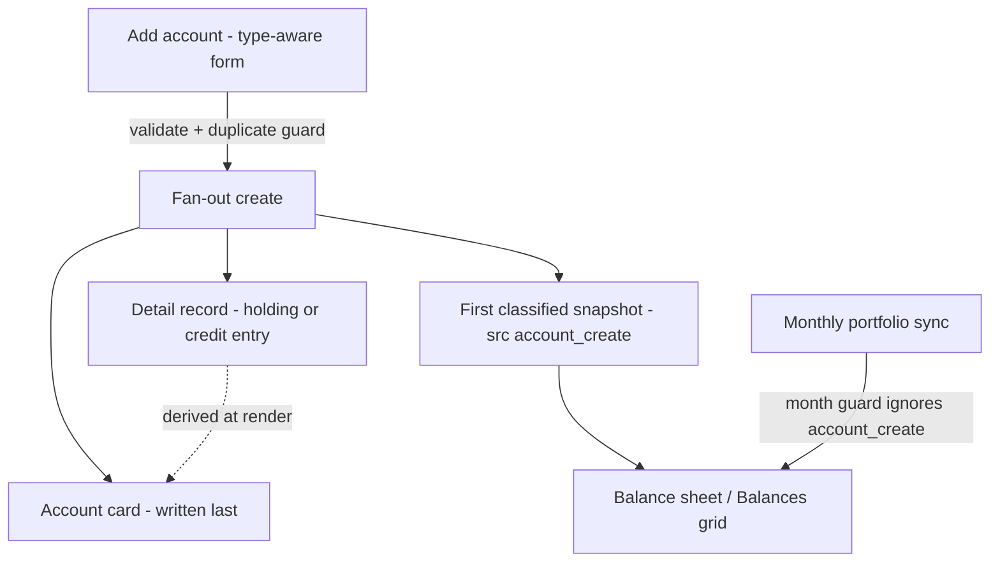

# Dynamic Account Entry - Plan

## Goal Capsule

- **Objective:** Make the Accounts page's Add-account flow type-aware — Bank/cash, Credit card, Common stock, Loan — with a fan-out create (account card + linked detail record + first classified balance snapshot), derived-at-read values on linked cards, and archive-not-delete lifecycle.
- **Product authority:** This document. Product Contract confirmed in dialogue 2026-07-15; derive-at-read revision user-approved same day.
- **Product Contract preservation:** changed R7 — detail→card value *push* became value *derived at render* (user-approved); R2 gained an optional opening-balance field for credit cards; R10–R12 added from flow analysis (duplicates, reopen, bank/loan loop). All other R/F/AE text unchanged.
- **Stop conditions:** Surface rather than guess if the live `accountCategories` vocabulary contradicts the preset table (KTD-5), or if migrated liability snapshots turn out to be stored positive (A2).
- **Open blockers:** None. Two deferred items in Open Questions.

---

## Product Contract

### Summary

The Add-account form gains an account-type choice — Bank/cash, Credit card, Common stock, Loan — and shows only that type's fields. Saving fans out: the account card, a linked detail record for stock (portfolio holding) and credit (Credit-page registry entry) sharing the account's ID, and the account's first fully classified balance snapshot. Linked cards display values derived at render from their detail record; bank/loan cards keep a stored, editable balance.

### Problem Frame

The Add-account modal renders one flat field list for every account type — bank fields and credit fields mixed — and has no way to capture what a stock holding needs (ticker, shares, cost basis), so a stock added there is invisible to the price-refresh. The three representations of an account live in separate collections with no shared key: the credit registry joins to balance history by a name alias, the portfolio pushes values into account cards by ticker-name equality, and the same credit facts (limit, APR, fees) are stored twice in two different field vocabularies. A newly created account also stamps balance snapshots with no Institution, no Class, and no account number (there is no prior snapshot to inherit them from), and the coarse account Type stands in for the granular account type on the Balances grid. The result: double entry, silent drift between copies, and balance-sheet rows with blank or coarse columns.

### Key Decisions

- **Type presets with fan-out on save.** Picking a type sets the field set and the full balance-sheet classification; the user does not hand-enter classification fields for new accounts.
- **The detail record owns financial truth; linked cards derive their value at render.** Stock cards read the holding's Current Value, credit cards read the newest balance snapshot (the Credit page's existing computation). No stored copy exists to drift. Bank/loan cards keep a stored, editable Amount.
- **Archive over delete for new linked accounts.** Removing a linked account closes card + detail record together; nothing is hard-deleted and balance history is untouched. Reopen is the symmetric paired action.
- **New accounts only.** Migrated accounts, existing holdings, and existing credit entries keep today's name-based behavior; no backfill. The legacy ticker-name value-push keeps running for migrated accounts.
- **Loan accounts are card + snapshot only.** No detail record; loans do not feed the Credit page at launch.
- **Wrong type is corrected by archive + recreate.** Duplicate checks consider only active records, so recreation is never blocked by an archived ghost.

### Requirements

**Type-aware entry**

- R1. The Add-account form offers exactly four types at launch — Bank/cash, Credit card, Common stock, Loan/other liability — and the visible field set changes with the chosen type.
- R2. Each type captures its own fields: Bank/cash — name, institution, balance. Credit card — name, institution, credit limit, APR, minimum payment, annual fee, opened date, optional opening balance. Common stock — ticker, shares, purchase price, brokerage. Loan — name, institution, balance owed, APR, minimum payment, opened date.
- R3. The chosen type stamps the account's full balance-sheet classification (class, group, category, institution, granular account type); classification fields are not free-text on this form.

**Fan-out on save**

- R4. Saving a Common stock account also creates its portfolio holding, in the shape the price-refresh requires (resolvable ticker, numeric shares), sharing the account's ID.
- R5. Saving a Credit card account also creates its Credit-page registry entry (limit, APR, minimum payment, annual fee, opened date), sharing the account's ID.
- R6. Every new account writes its first classified balance snapshot on save, so it appears on the balance sheet and Balances grid immediately — institution, class, account number, and granular account type all present.
- R10. Creation is rejected when an active record with the same name or ticker already exists (case-insensitive) in accounts, holdings, or the credit registry; archived records do not block. A detail record with no account card counts as a stray from a failed save — it is replaced (with the usual deletion audit), not treated as a duplicate.

**Linked lifecycle (new accounts only)**

- R7. A linked card's value is derived at render from its detail record — stock from the holding's Current Value, credit from the newest balance snapshot; the value and the card's name, status, and type-owned fields are not editable on the card, which points to the owning page.
- R8. Removing a new linked account archives it: card and detail record marked closed, hidden from active views, price-refresh and credit tracking stop, balance history untouched.
- R9. Pre-existing records keep current behavior; no backfill or retroactive linking.
- R11. An archived linked account can be reopened by one paired action that restores card and detail record to active tracking together.

**Bank/loan upkeep**

- R12. Bank and loan cards keep the existing loop — edit Amount, stamp with "Add to Balances" — and those stamps carry the account's stored granular type instead of the coarse Type.

### Key Flows

- F1. Add a stock
  - **Trigger:** Add account → type Common stock → ticker, shares, purchase price → save.
  - **Outcome:** Holding + classified snapshot + account card exist, linked by the card's Account ID; the Accounts page shows the holding's value; the next price refresh updates the holding and the card follows automatically.
  - **Covers:** R1–R4, R6, R7, R10.
- F2. Add a credit card
  - **Trigger:** Add account → type Credit card → limit, APR, fees, optional opening balance → save.
  - **Outcome:** Credit-page entry + snapshot + card; Credit page shows the limit and computes utilization from snapshots; the card displays the newest snapshot balance.
  - **Covers:** R1–R3, R5, R6, R10.
- F3. Archive a linked account
  - **Trigger:** Archive action on a new linked account's card.
  - **Outcome:** Card and detail record closed; absent from active Accounts/Investments/Credit views and from future syncs; prior balance-sheet months unchanged.
  - **Covers:** R8.
- F4. Reopen an archived linked account
  - **Trigger:** Reopen action on the card (visible in the Closed status view).
  - **Outcome:** Card and detail record active again; refresh/sync/tracking resume.
  - **Covers:** R11.

### Acceptance Examples

- AE1. **Covers R4, R7.** Given a new Common stock account "AAPL", 10 shares — when the price refresh runs, the holding's value updates from the live quote and the Accounts page shows that value on the card; the card offers no editable amount.
- AE2. **Covers R5.** Given a new Credit card account with a 5,000 limit — the Credit page lists it with that limit, and utilization appears once a balance snapshot for it exists.
- AE3. **Covers R3, R6.** Given a new Bank/cash account saved with a balance — the current month's balance sheet shows it under Current Assets with its institution filled, without any manual "Add to Balances" step.
- AE4. **Covers R8.** Given an archived new stock account — active Accounts and Investments views omit it, the refresh and sync skip it, but last month's balance sheet still shows its recorded value.
- AE5. **Covers R6 + month-guard interplay.** Given a stock account created on the 3rd — a portfolio sync later the same month still appends that ticker's balance rows (the creation snapshot does not freeze it out).
- AE6. **Covers R10.** Given an archived credit card "Visa X" — creating a new account named "Visa X" succeeds; creating it again while the first is active is rejected with a clear error.

### Scope Boundaries

- No backfill of the ~54 migrated accounts, existing holdings, or existing credit entries — two regimes coexist by design.
- Four launch types; adding a type later is a code change, not user-configurable.
- No changes to the Investments or Credit pages' own editing flows.
- Cash-equivalent brokerage positions (money-market funds) are not a distinct type at launch; enter as Bank/cash or manage directly in the portfolio.

**Deferred to Follow-Up Work**

- Network ticker validation at save (typo detection); the Investments page's existing failed-refresh list is the safety net for now.
- Changing an account's type in place — unsupported; archive + recreate is the documented path.

### Outstanding Questions

**Deferred to Planning — resolved this pass**

- Partial-failure behavior → resolved by write ordering (KTD-3): detail record and snapshot first, card last, so no orphan card is ever visible.
- Credit field-vocabulary bridge → resolved (KTD-2): the registry keeps its snake_case fields; the link is a new `account_id` field, and the card stops storing credit facts' value copy.

---

## Planning Contract

### Key Technical Decisions

- KTD-1. **Derive-at-read for linked card values.** The accounts adapter overlays values after loading account docs: one batch query for linked holdings (by link ID) and one for newest snapshots of linked credit cards (the same newest-snapshot-per-account query `app/credit.py` runs). Overlay happens before section building so page group totals use derived values. Replaces hardening the name-based push; the legacy push in `app/investments.py` (ticker-name `update_one`) is left untouched for migrated accounts and is a harmless no-op-or-overwrite on new cards, whose display ignores stored Amount.
- KTD-2. **Link representation.** The account card keeps its minted `Account ID` ("MAN-…"). The detail record carries a new `account_id` field holding that value — the credit registry's uuid `_id` and the holding's `_id` are untouched, so every legacy join (name alias, ticker equality) keeps working for old records. Credit entries also set `balance_account` = the card's `Account` name so utilization works with zero `app/credit.py` join changes; the `account_id` field is lifecycle metadata (archive/reopen, derive-at-read).
- KTD-3. **Fan-out seam and write order.** `CardCollection.create` gains an optional async `fan_out(doc)` hook awaited after `clean()` + `on_create` and **before** the card insert. The accounts adapter's hook: duplicate guard (R10), normalize ticker (uppercase, dots preserved for storage; `normalize_ticker` handles yfinance form), insert detail record, append first snapshot, then return — card insert happens last, so a mid-fan-out failure never produces an account card. A stray detail record from a failed save is visible on its owning page and to syncs until replaced; the duplicate guard therefore treats a matching detail record with no active account card as a stray — the retry deletes it (audited, ADR-0005) and recreates it, rather than rejecting.
- KTD-4. **Creation snapshot `_src: "account_create"`, excluded from the month guard.** `sync_portfolio_to_balances` currently skips any Account with a non-`portfolio_sync` row this month; the guard's filter becomes `_src: {"$nin": ["portfolio_sync", "account_create"]}` so a new stock's creation snapshot does not freeze its sync for the rest of the month (AE5). Manual stamps keep their authority. Sync rows for linked holdings stamp the card's `Account ID` so the account's snapshot stream carries one ID.
- KTD-5. **Classification preset table** (verified against `app/lookups.py` cascade seeds, `app/investments.py` maps, `app/routers/reports.py` canonicalization; Type__15 = Category follows both existing sync writers):

  | Type | Category | Group | Type/Class | Type__15 |
  |---|---|---|---|---|
  | Bank/cash | Checking Account | Current Assets | Assets | Checking Account |
  | Credit card | Credit Card Debt | Current Liabilities | Liabilities | Credit Card Debt |
  | Common stock | Common Stock | Stockholder's Equity | Equity | Common Stock |
  | Loan | Loan | Current Liabilities | Liabilities | Loan |

  Class written plural (`Assets`/`Liabilities`/`Equity`) like both existing snapshot writers; `_canon_class` reconciles migrated singular rows. The preset's granular type is stored on the account doc (new `Account Type` field) so later "Add to Balances" stamps carry it (R12). Ensure `accountCategories` has a `Loan` row (insert if missing) so the lookup cascade governs it afterwards.
- KTD-6. **Type-aware modal via a select field kind + per-type config.** `CardField` gains kind `select` (options list) for the type field; a per-type visible-field map rides `window.CARD` (same channel the field list already uses); client shows/hides the existing rendered inputs. The modal opens with a "Choose a type…" placeholder, no type-specific fields visible, and Save disabled until a type is chosen. Switching type clears the values of fields leaving the visible set, so the create payload's omit-hidden-empty behavior holds and no stale value resurfaces. Server-side, accounts' `clean()` applies the per-type allowlist so hidden fields can't be smuggled in.
- KTD-7. **Archive markers per collection.** Card `Status: "Closed"` (existing filter semantics), credit `status: "Closed"` (drops out of `ACTIVE_STATUSES`), holding — first-ever portfolio flag — app-owned `_closed: true`, honored in the three query sites: refresh targets, sync doc build, and the Investments page rows. Credit's account list gains an active-only default view. Reopen reverses all of it in one action.
- KTD-8. **Liability sign.** Snapshots for credit/loan store negative balances (credit reads `abs()`, balance sheet nets liabilities); the form label says "balance owed", the user types positive, create negates for Liability-class types. Verify against migrated liability rows before locking the sign (A2).

### Assumptions

- A1. Live Atlas `accountCategories` is richer than the test seeds; the KTD-5 table is consistent with everything in-repo, but the implementer confirms the Bank and Loan rows exist (inserting the Loan row if absent).
- A2. Migrated liability snapshots store negative balances. If inspection shows positive, flip KTD-8's negation and adjust the balance-sheet expectation in tests.
- A3. Single user; no concurrent-create races worth guarding beyond the duplicate check.

---

## Implementation Units

### U1. Type-aware Add modal

- **Goal:** Type selector drives the visible field set; presets stamp classification on the card doc.
- **Requirements:** R1, R2, R3.
- **Dependencies:** none.
- **Files:** `app/card_collection.py` (select kind), `app/templates/card_collection.html` (select rendering), `app/static/js/card-editor.js` (per-type show/hide), `app/static/js/accounts.js` (type config), `app/routers/accounts.py` (type definitions, per-type field lists, preset map, stored `Account Type`), `tests/test_card_collection.py`.
- **Approach:** KTD-5, KTD-6. Type field appears only in create mode (existing cards keep their coarse Type field untouched). Per-type allowlist enforced in accounts' clean path.
- **Test scenarios:** select kind renders options; modal opens with placeholder, no type fields, Save disabled until a type is chosen; switching type clears values of fields leaving the visible set; create payload for stock type carries ticker/shares/purchase price and no credit fields; server strips a credit field smuggled into a stock create; preset stamps Category/Group/Type/`Account Type` on the stored doc; bank type stores editable Amount.
- **Verification:** pytest green; Add modal in the running app switches field sets when type changes.

### U2. Fan-out create, duplicate guard, first snapshot

- **Goal:** One save produces detail record + first classified snapshot + card, ordered so no orphan card can appear; duplicates against active records are rejected.
- **Requirements:** R4, R5, R6, R10; AE3, AE6.
- **Dependencies:** U1.
- **Files:** `app/card_collection.py` (async `fan_out` hook), `app/routers/accounts.py` (accounts fan-out: dedupe, holding doc, credit entry, snapshot), `tests/test_account_entry.py` (new).
- **Approach:** KTD-2, KTD-3, KTD-4 (snapshot `_src: "account_create"`), KTD-8 (sign; credit optional opening balance, default 0). Holding doc follows the seeded shape — string money via the existing `money()` format, `Shares` as string, `Group: "Equity"`, `Type: "Individual Stock"`, `Category: "Common Stock"`, `Account` = brokerage, plus `account_id`. Credit entry via `registry.add_doc` with `account_id` and `balance_account` extra fields; amounts through `values.parse_amount`, APR through credit's percent-or-fraction rule.
- **Test scenarios:** Covers AE3 — bank create → snapshot has Institution, Class "Assets", Account #, granular Type__15, and the balance sheet shows it; stock create → holding is refresh-eligible (resolvable ticker, nonzero shares) and shares the card's Account ID; credit create → registry entry has snake_case fields, `balance_account` = card name, `account_id` link; Covers AE6 — duplicate active name rejected 400, archived name allowed; fan-out failure before card insert leaves no account card; retry after a mid-fan-out failure audited-deletes the stray detail record and succeeds; zero shares rejected; lowercase ticker normalized; credit with no opening balance → snapshot Balance 0; loan "balance owed" 500 stored as −500.
- **Verification:** pytest green; one POST to `/api/accounts/row` in the running app produces all three records.

### U3. Month-guard exclusion and sync identity

- **Goal:** A new stock's creation snapshot doesn't suppress its portfolio sync; sync rows carry the linked card's Account ID.
- **Requirements:** R6, R9; AE5.
- **Dependencies:** U2.
- **Files:** `app/investments.py`, `tests/test_investments.py`.
- **Approach:** KTD-4. Guard filter `$nin: ["portfolio_sync", "account_create"]`; `build_balance_doc` uses the holding's `account_id` when present, existing synthesized ID otherwise (legacy holdings unchanged).
- **Test scenarios:** Covers AE5 — account_create row this month + sync → ticker's rows still append; manual-stamp row this month still skips (regression on existing guard test); linked holding's sync row carries the MAN- Account ID; legacy holding still gets the sha ID.
- **Verification:** pytest green including the pre-existing month-guard tests.

### U4. Derive-at-read values and linked-card behavior

- **Goal:** Linked cards display detail-record values; type-owned fields lock; "Add to Balances" hides for stock/credit; bank/loan stamps carry granular type.
- **Requirements:** R7, R9, R12; AE1 (display half), AE2 (display half).
- **Dependencies:** U2.
- **Files:** `app/routers/accounts.py` (overlay before section build), `app/card_collection.py` (per-doc readonly support if needed), `app/static/js/accounts.js` + `app/static/js/card-editor.js` (display-only fields, owning-page pointer, hide the stamp button), `app/routers/balances.py` (stamp `Type__15` from stored `Account Type` when present), tests in `tests/test_account_entry.py` + `tests/test_card_collection.py`.
- **Approach:** KTD-1. Two batch queries: holdings keyed by `account_id`; credit snapshots joined by the card's Account name via the same newest-snapshot-per-account pipeline as the Credit page, so manually added Balances-grid rows (which carry no Account ID) surface on the card. Overlay replaces the serialized amount for linked cards; section totals therefore derived. Server rejects updates to locked fields on linked docs (dirty-diff means honest clients never send them). The locked card's modal shows a per-type owning-page link — "Manage on Investments" for stock, "Manage on Credit" for credit.
- **Test scenarios:** stock card shows holding's Current Value not stored Amount; editing shares (holding doc) changes the Accounts page value with no refresh push; credit card shows newest snapshot balance; a Balances-grid row added by name for a linked credit card updates the derived card value; POST updating `Account` on a linked card → 400; bank card Amount still editable; the owning-page link renders on locked linked cards (Investments for stock, Credit for credit); from-account stamp on a preset bank account carries `Type__15: "Checking Account"`; legacy account stamp unchanged (coarse Type fallback).
- **Verification:** pytest green; Accounts page in the running app shows a derived value that changes after editing the holding.

### U5. Archive and reopen lifecycle

- **Goal:** One action closes card + detail record together; reopen restores both; closed holdings leave refresh, sync, and the Investments page.
- **Requirements:** R8, R9, R11; AE4.
- **Dependencies:** U2, U4.
- **Files:** `app/routers/accounts.py` (archive/reopen actions replacing delete for linked cards), `app/investments.py` (`_closed` filter in refresh targets + sync build), `app/routers/investments.py` (page rows filter), `app/credit.py` (active-only account list default), `app/static/js/accounts.js` (action buttons per status), tests across `tests/test_account_entry.py`, `tests/test_investments.py`, `tests/test_credit.py`.
- **Approach:** KTD-7. Unlinked (bank/loan/legacy) cards keep the existing audited hard-delete; linked cards get archive/reopen instead.
- **Test scenarios:** Covers AE4 — archive stock → holding `_closed`, refresh skips it, sync appends nothing for it, Investments page omits it, prior balanceHistory rows intact; archive credit → status Closed, utilization list omits it; reopen restores both sides and tracking resumes; archived card hidden from default Accounts view, visible under `?status=closed`; hard-delete still works (audited) on an unlinked card.
- **Verification:** pytest green; archive → reopen round-trip in the running app.

### U6. Acceptance sweep and vocabulary

- **Goal:** End-to-end coverage of AE1–AE6 as written; domain terms recorded.
- **Requirements:** all AEs; documentation.
- **Dependencies:** U1–U5.
- **Files:** `tests/test_account_entry.py` (AE-labelled end-to-end cases), `CONTEXT.md` (terms: Account type preset, Linked account, Archive — with _Avoid_ synonyms per house style).
- **Approach:** Each AE gets one test tracing the full path (create → refresh/sync → report) using the conftest seeds plus per-test inserts.
- **Test scenarios:** Covers AE1, AE2, AE3, AE4, AE5, AE6 — one each, named for the AE.
- **Verification:** full suite green.

---

## Verification Contract

| Gate | Command | Applies to |
|---|---|---|
| Unit + integration tests | `./.venv/bin/python -m pytest -q` | every unit; full suite must pass, including pre-existing month-guard and card-collection tests |
| Fan-out smoke | run `./.venv/bin/uvicorn app.main:app --port 8010`, add one account of each type, verify Accounts / Investments / Credit / Balance Sheet surfaces | U2–U5 |
| Regression guard | existing tests in `tests/test_investments.py`, `tests/test_card_collection.py`, `tests/test_credit.py`, `tests/test_reports.py` unmodified except where a requirement changed behavior (each such change named in the diff) | U3–U5 |

## Definition of Done

- All six units landed; full pytest suite green.
- AE1–AE6 each demonstrated by a named test.
- One save of each launch type produces the correct record set with no orphans; archive → reopen round-trips.
- A1/A2 verified against live data (accountCategories rows present; liability sign confirmed) with the outcome noted in the implementing PR.
- No dead experiments left in the diff; `CONTEXT.md` terms added.

---

## Sources

- Verified against source 2026-07-15: single static field list (`app/routers/accounts.py`); credit module never references the accounts collection (`app/credit.py`); portfolio→card push is ticker-name equality and the month guard skips non-sync rows (`app/investments.py`); fresh stamps lack Institution/Class/Account # and Type__15 is coarse for all stamped snapshots (`app/routers/balances.py`, `app/routers/reports.py`); snapshot shape and append-record semantics (`app/snapshot.py`); registry insert mints uuid `_id` (`app/registry.py`); modal renders one static field list with no conditional support (`app/card_collection.py`, `app/templates/card_collection.html`, `app/static/js/card-editor.js`).
- Classification vocabulary assembled from `app/lookups.py` (accountCategories cascade), `tests/test_categories.py` seeds, `app/investments.py` maps, `app/routers/reports.py` (`CLASS_ORDER`, `_canon_class`), `scripts/import_account_categories.py`.
- Holding doc shape from `tests/test_investments.py` seeds and `app/investments.py` consumers; credit field rules from `app/credit.py` (`_ACCOUNT_FIELDS`, percent-or-fraction APR, `ACTIVE_STATUSES`).
